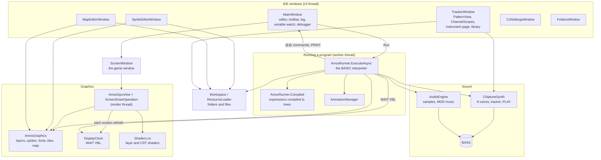
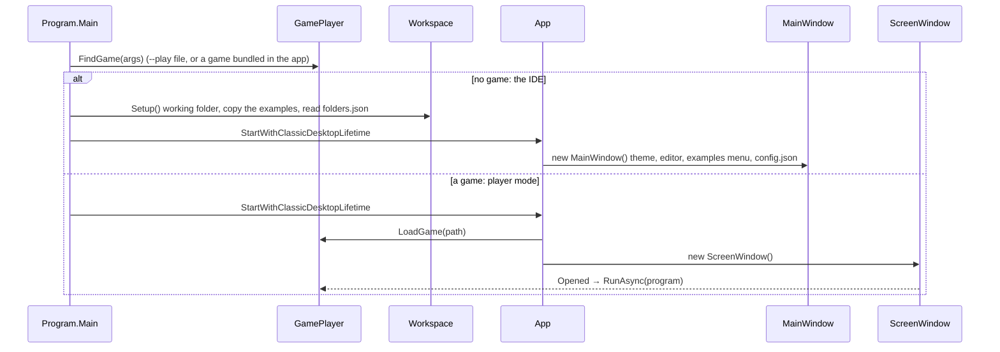
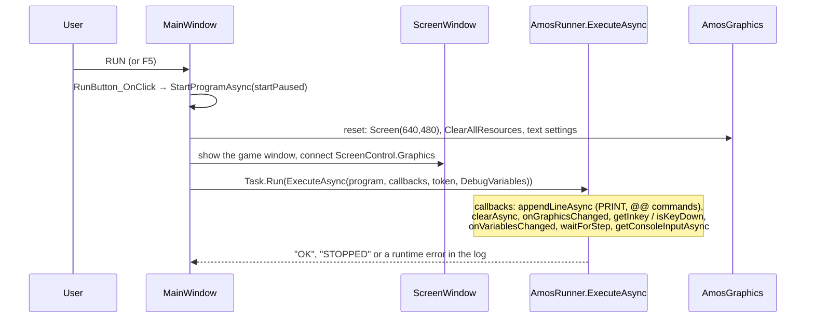
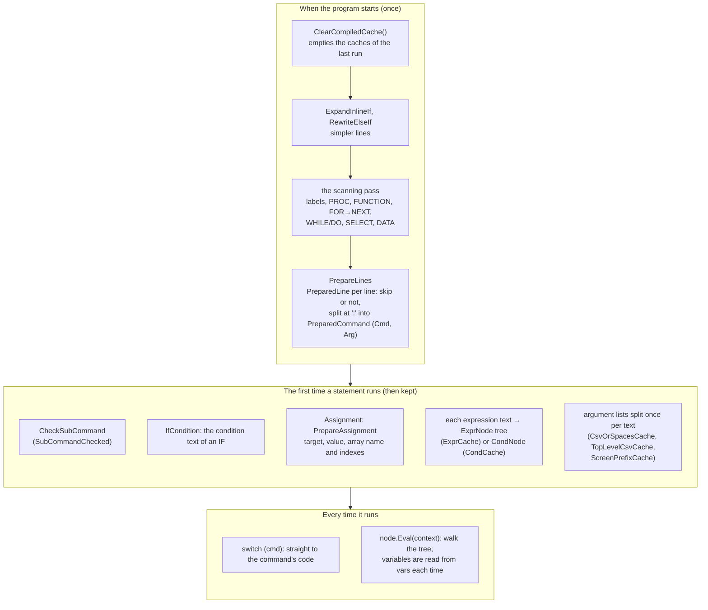
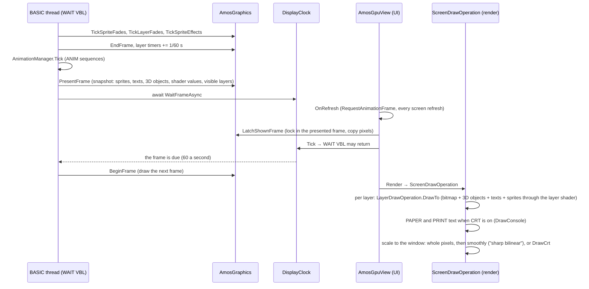
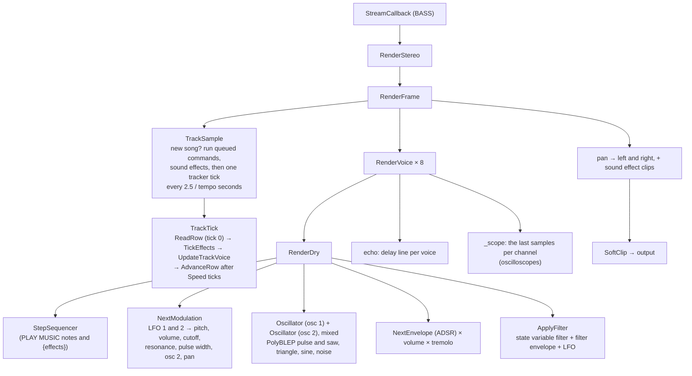
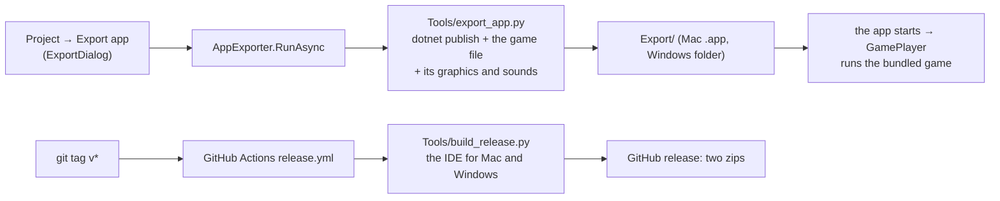

# AMOS Like Basic – architecture

How the program is built, which parts talk to which, and in what order the important functions
are called. It is written for someone who is about to change the code. For *using* the program,
see the manual; for the finer points of the game screen, see `Info.txt`.

The app is a C# / .NET 9 desktop program built on **Avalonia 12** (windows, controls),
**SkiaSharp** (drawing and shaders, on the GPU where there is one) and **BASS** through
ManagedBass (sound output, samples and music modules). It is one project, `AmosLikeBasic.csproj`,
plus the test project in `Tests/`.

## 1. The big picture

The code is in four projects in this repository:

| Project | What it is |
|---|---|
| `AmosLikeBasic.Core` | The engine, no windows: `ChiptuneSynth` (the synth, tracker playback, sound effects, WAV export), `TrackerSong` and its instruments, `SampleBank`, the `Ym2149` with `YmFile` / `YmPlayer`, the readers `ModImport`, `XmImport`, `YmImport`, `InstrumentSimplifier`, and the basics: `Workspace`, `ResourceLoader`, `ConfigService`, `AudioOutput` |
| `AmosLikeBasic.Tracker` | The tracker's windows and controls (`TrackerWindow`, `PatternView`, `ChannelScopes`, `Knob`, `InstrumentGraphs`, `InstrumentLibraryWindow`, `YmBrowserWindow`) and the AMOS look shared by both apps: `AmosStyles.axaml` (theme colours and control styles), `AmosThemes`, `ThemeResources` |
| `AmosLikeBasic` | The IDE: `MainWindow`, the interpreter, graphics, the sprite and map editors, `AudioEngine` for `SAM` and `MUSIC` |
| `AmosTracker` | AMOS Tracker: the tracker as an app of its own, with the same settings, theme and sound card |

The IDE uses both libraries, the tracker app only the two libraries; the tests use the IDE (and so all of them). All the code is in the namespace `AmosLikeBasic`.

The IDE and an exported game share the same engine. The only difference is who starts it: the
IDE (`MainWindow`) or the player (`GamePlayer`), which runs a game bundled into the app.

## 2. Threads

Four threads take part, and most of the design is about handing data safely between them.

| Thread | What runs there | Owns |
|---|---|---|
| **UI** (Avalonia) | the windows, the editor, the tracker, `ScreenConsole` (the `PRINT` text box) | controls; it reads `AmosGraphics` under `LockObject` |
| **BASIC worker** (`Task.Run`) | `AmosRunner.ExecuteAsync`: the whole program | the variables; draws into the layer bitmaps |
| **Render** (Avalonia/Skia) | `ScreenDrawOperation.Render`: layers, shaders, scaling, CRT | GPU surfaces; it only reads snapshots |
| **Audio** (BASS callback) | `ChiptuneSynth.RenderStereo`: every sample | the synth's voices and tracker state |

The rules that keep them apart:

- The BASIC thread **never touches controls**. It sends text such as `@@PRINT hello` through
  `appendLineAsync`, and `MainWindow.AppendConsoleLineAsync` carries it out on the UI thread
  (`ScreenConsole.Apply`).
- The render thread **draws snapshots**, not the live state: `WAIT VBL` hands over a frame with
  `PresentFrame`, and each screen refresh locks one in with `LatchShownFrame` (section 5).
- The UI and BASIC threads talk to the synth through a **command queue**
  (`_trackCommands`), which the audio thread empties at the start of every sample, or by writing
  whole settings (an LFO's `LfoSettings` is never changed, only replaced).
- The variable watch reads and changes variables **only while the program is paused** at
  `waitForStep`, when the BASIC thread stands still (`DebugVariables`).

## 3. Starting the app

`Workspace.Setup` decides where relative paths in programs count from:

- **From the source code** it is the repository.
- **Installed** it is `Documents/AmosLikeBasic`.
  - `Projects`, `Graphics` and `Sound` are copied there, and unchanged examples are updated by
    new versions, using fingerprints in `.copied.json`.
  - An `Export` folder is made.
- **Project → Folders** can move the four folders; the choice is kept in `folders.json`.

`ResourceLoader.GetPath` finds a file in this order:

1. a moved `Graphics` or `Sound` folder,
2. the working folder,
3. the files inside the app.

## 4. Running a program

### 4.1 From the Run button to the interpreter

### 4.2 Inside `ExecuteAsync`

The interpreter works on the program text, prepared once, then runs it line by line. In order:

1. **Split into lines** and reset the run state: the variables, the stacks for `FOR`, `WHILE`,
   `REPEAT`, `GOSUB`, `PROC` and functions, the tracker song, the start time and `CONST`s.
2. **Rewrite** the lines into a simpler form, keeping a map back to the editor's line numbers
   (`sourceLines`) for the debugger and error messages:
   - `ExpandInlineIf` turns `IF x THEN a : b ELSE c` into a block `IF`;
   - `RewriteElseIf` turns `ELSEIF` into nested `IF`s;
   - comments are stripped (`StripComments`) and line numbers removed (`StripLeadingLineNumber`).
3. **One scanning pass** over the lines builds the jump tables, so that nothing is searched for
   while the program runs:
   - labels (`Loop:`, line numbers);
   - `FUNCTION ... END FUNCTION`;
   - `PROC ... END PROC`;
   - `FOR` → its `NEXT` (`forNext`);
   - `WHILE`/`DO` → `WEND`/`LOOP`;
   - `SELECT` → its `CASE`s and `END SELECT`;
   - `DATA` values.
4. **Prepare** each line as a `PreparedLine` with its `PreparedCommand`s: the statements split at
   `:`, each split into command and argument. Things such as an assignment or an `IF` condition
   are worked out the first time the statement runs and kept on the command (see 4.4).
5. **The main loop** (`while pc < lines.Length`), for every line:
   1. `await waitForStep(line)` once per source line. That is where the debugger pauses, stops
      at a breakpoint and lets the variable watch read and change variables.
   2. For every command: an assignment (`A = …`, `A(i) = …`), or the big `switch (cmd)` with
      one `case` per command (`PRINT`, `SPRITE`, `WAIT`, `PLAY`, `TRACK`, `MAP` …). Commands
      with sub-commands check them (`CheckSubCommand`), so a misspelt one gives a clear error.
   3. Jumps (`GOTO`, `GOSUB`, `NEXT`, `WEND`, procedure calls) set `pc` and leave the command loop.
   4. An exception becomes `ERR$`/`ERL`, and depending on `ON ERROR`:
      - `RESUME NEXT` goes on;
      - `GOTO` jumps;
      - otherwise the run ends with "Runtime Error at line …".

      A cancelled run (Stop, a new run) ends quietly.
6. **Variables** live in one dictionary (`vars`) and are set through `setVar`, which:
   - refuses changes to a `CONST`;
   - drops the decimals of `A%`;
   - reports the variables to the watch at most twice a second (`onVariablesChanged`).

   `LOCAL` variables in a `PROC` are saved and put back around the call.

### 4.3 Expressions

`EvalValue(text, …)` turns the text of an expression into a tree of `ExprNode`s the first time
(`CompileExpression`, cached in `ExprCache`), and evaluates the tree after that (more in 4.4).
The grammar is in levels, from loosest to tightest:

`CompileExpr` (OR, XOR) → `CompileAnd` → `CompileNot` → `CompileCompare` → `CompileSum`
(+, −, `&`) → `CompileTerm` (\*, /, `\`, MOD) → `CompilePower` (^) → factors: numbers, strings,
variables (`VarNode` reads `vars` every time), array elements, built-in functions (the table
`BuiltinFunctions`, e.g. `CHR$`, `PETSCII$`, `TILE`, `MICROS`) and user `FUNCTION`s.

Anything the compiler does not know yet falls back to the older recursive interpreter
(`ParseExpr` → `ParseAnd` → … → `ParseFactor`, wrapped as `InterpretedFactorNode`). Both read
the same variables, so it makes no difference to a program which one ran.

### 4.4 Precompilation: what is done once, and what every time

The interpreter does not compile the whole program to code before it runs. It does the work in
three steps, as early as each piece can be done, and keeps the result, so that a line that runs
again and again (a game loop) costs as little as possible.

**When the program starts.** `ExecuteAsync` empties the caches (`ClearCompiledCache`), rewrites
the lines and builds the jump tables (4.2). `PrepareLines` then makes one `PreparedLine` per line:
- empty lines, comments, `REM` and labels are marked `Skip`;
- the rest is split at `:` into `PreparedCommand`s, each with its command word (`Cmd`) and the
  rest (`Arg`).

So the main loop never splits a line or looks for a label while it runs.

**The first time a statement runs**, the rest of the parsing is done and stored on the
`PreparedCommand`:
- `SubCommandChecked` – the sub-command was checked against `SubCommands` (`SPRITE MOOVE`
  gives an error once, and correct ones are not checked again);
- `IfCondition` – the condition text of an `IF`;
- `Assignment` – `PrepareAssignment` splits `A(I, 2) = X + 1` into target, value, array name
  and index texts.

**Expressions** are compiled by their text:
- `EvalValue(text)` looks the text up in `ExprCache`, and the first time compiles it with
  `CompileExpression` into a tree of `ExprNode`s;
- conditions get `CondNode` trees in `CondCache`.

The tree is made of small node classes:
- `ConstNode` – a number or string worked out once;
- `VarNode` – reads the variable;
- `AddNode`, `ConcatNode`, `CompareNode`, `AndNode` and the other operators;
- `CallNode` – a function or an array element.

The same text on two lines shares one tree.

**Every time**, what is left is cheap:
- the `switch (cmd)` jumps straight to the command's code;
- `node.Eval(context)` walks the tree.

Variables are read from the `vars` dictionary each time. That is why the debugger can change a
variable while the program is paused and the program uses the new value straight away.

**A `CallNode`** decides each time, in this order:
1. a user `FUNCTION` with that name;
2. a built-in function compiled to C# (`NativeBuiltins`, e.g. `SIN`, `CHR$`, `PETSCII$`,
   `TILE`), when the number of arguments fits;
3. an array element (`A(3)`);
4. otherwise the old interpreter (`InterpretFactor`) runs the call.

**When the compiler does not understand something**, it does not fail. It wraps that part for the
old recursive interpreter (`ParseExpr` … `ParseFactor`), which reads the same variables, so the
program behaves the same either way:
- a whole expression it cannot parse becomes an `InterpretedExpr`;
- a call with unusual arguments becomes an `InterpretedFactorNode`.

That made it possible to move the common cases over to compiled trees step by step without
changing any program's behaviour.

**What is not precompiled.** A command's own arguments, such as the four values of
`SPRITE POS`, are still taken apart in the command's `case` each time it runs. The splitting is
cached by text, and each value goes through `EvalValue` and its tree, so it is mostly lookups.
A real compile of whole statements to code (for example with `System.Linq.Expressions`) would be
the next step if a program ever needs more speed.

## 5. A frame: from `WAIT VBL` to the screen

Layers are `GpuLayer`s in `AmosGraphics.ActiveFrame`, each with one `WriteableBitmap` at the
game's resolution. Drawing commands (`PLOT`, `BAR`, `PRINTG`, `TILE DRAW` …) write straight into
it on the BASIC thread. Sprites, bobs and `FONT PRINT` texts are kept as lists and drawn on top
when the screen is drawn.

**Handover.** The frame is handed over *before* the wait. That way the refresh always shows the
frame the program has just finished, with everything from the same frame.

**DisplayClock.**
- `WAIT VBL` follows the window's real refreshes: every refresh at 60 Hz, every second one at
  120 Hz.
- After 100 ms without refreshes it falls back to a timer (a hidden window, tests).
- Two refreshes within 3 ms count as one (`IsDuplicateRefresh`).

**The layer shader** (`Shaders.cs`, `RasterShaderCode`) does in one pass, per layer:
- scrolling,
- raster bars,
- `RASTER COLOUR` (raster on one colour),
- `PARTICLE` weather,
- other effects.

**3D objects** (`Scene3D.cs`, state in `AmosGraphics.ThreeD.cs`): `OBJECT`, `CAMERA`, `LIGHT`.
- The shapes (`Mesh3D`) are lists of triangles, never changed once made.
- `Renderer3D` turns and projects the corners on the CPU, shades them per corner, cuts them at
  the near plane, sorts all the triangles of a layer from the back to the front (no depth
  buffer) and draws each run from one object with one `DrawVertices`, the texture times the
  corner colours.

**Measuring.** `AMOS_FRAMELOG=file` logs every refresh, `WAIT VBL` and draw (`FrameLog.cs`).

## 6. Sound

Two engines share the BASS output:

- **ChiptuneSynth** – a synthesizer written in C#: `PLAY` commands and melodies, the tracker's
  songs and sound effects (`TRACK`), and the tracker window's preview.
- **AudioEngine** – BASS's own streams: sample files (`SAM PLAY`, sound effects) and music
  modules (`MUSIC` with `.mod` files).

### 6.1 One sample of the synth

BASS calls the stream callback for a buffer of stereo samples. For every sample:

Notes:

- **A tracker song** is compiled once (`CompileSong`, `CompileInstrument`), from the
  `TrackerSong` read from the `.amostrk` JSON, into `TrackData` and `TrackInstrument`s with
  everything in the synth's units.
- **Instrument settings on a note.** `TriggerTrackNote` starts a note and calls
  `SetVoiceFromInstrument`. When an instrument is changed while it sounds,
  `TrackInstrumentChanged` calls `SetVoiceFromInstrument` again without starting the note, so a
  turn of a knob is heard at once.
- **Mono render.** `Render` (mono) is the middle of the stereo mix. The tests measure with it,
  and a voice in the middle sounds exactly as in mono.
- **WAV export.** `RenderSong` renders a song faster than real time, for the export (`WriteWav`).
- **Where the settings come from.** The same synth settings come from three places:
  - **tracker instruments:** `TrackerInstrument` → `CompileInstrument`;
  - **`PLAY` commands:** `SetOsc2`, `SetLfo`, `SetEcho`, `SetPan` …;
  - **`{ }` effects in melodies:** `ParseEffect`.

  The LFO parsing (`MakeLfo`) is shared, so they all mean the same.

### 6.2 The tracker window

`TrackerWindow` keeps a `TrackerSong` and its parts:

- **`PatternView`** – the pattern grid, keys, editing, mute and solo;
- **`ChannelScopes`** – an oscilloscope and level meter per channel; click to mute,
  right-click for solo;
- **the instrument page**:
  - `InstrumentScope`;
  - the graphs in `InstrumentGraphs.cs`;
  - `Knob`s, sliders and choice buttons;
- **`InstrumentLibraryWindow`** – the instrument library (`InstrumentLibrary`, files in
  `Sound/Instruments/<category>/`).

Every edit goes through `EditInstrument` or the pattern's own editing. These:

- push an undo step (the whole song as JSON);
- tell the synth: `TrackUpdate` while playing, `TrackInstrumentChanged` for sounding notes.

## 7. The editors

| Window | Works on | Notes |
|---|---|---|
| `SpriteEditorWindow` | a sprite in `AmosGraphics` (its frames are `WriteableBitmap`s) | <ul><li>tools from `GridTools` (line, rectangle, ellipse, fill) on BGRA pixels</li><li>"Pictures in the program" from `ProgramAssets.Find`</li><li>the sheet dialog guesses frames with `SheetGuess`</li></ul> |
| `MapEditorWindow` | the tile bank and map in `AmosGraphics` | <ul><li>the same `GridTools` on tile numbers</li><li>`MapView` and `TilePaletteView` draw it</li><li>figures for marker tiles are kept in the map file and ignored by `MAP LOAD`</li></ul> |
| `TrackerWindow` | a `TrackerSong` | see 6.2 |
| `CrtSettingsWindow` | `AmosGraphics.Crt*` | shows the `SCREEN CRT` line to copy |
| `FoldersWindow` | `Workspace` | |
| `ArrayViewerWindow` | an array from the variable watch | elements can be changed while paused |

`ProgramAssets.Find(programText)` reads the program's `SPRITE`, `IMAGE`, `TILE` and `MAP LOAD`
lines (with their sizes, or sizes from file names like `_W32_H56_B11`). That is how the editors
offer "the files in the program".

## 8. Exporting and releasing

`tests.yml` runs the tests on macOS and Windows for every push. Failed tests, or the end of the
output when the run crashes, appear as annotations on the run.

## 9. Generated content

Some files are made by scripts, so edit the script, not the file:

| File | Made by |
|---|---|
| `Projects/foresthop.amosproj`, `Graphics/ForestHop/level.amosmap` | `Graphics/ForestHop/build_game.py` |
| `Graphics/ForestHop/*.png` | `Graphics/ForestHop/generate_assets.py` |
| `Sound/Instruments/**/*.amosinst` | `Tools/build_instruments.py` |
| `Sound/Tracker/acid_sunrise`, `deep_space`, `pixel_rush` | `Tools/build_songs.py` |
| `Documentation/AMOS Like Basic - Manual.pdf` | `Tools/build_manual.py` from `Documentation/Manual/*.md` |

## 10. Tests

`Tests/` is an xUnit v3 project. Window tests run with `Avalonia.Headless` (real Skia drawing,
no screen), so they can capture frames.

| Test helper | What it does |
|---|---|
| `BasicRunner.Run(program, seconds, …)` | runs a BASIC program in a hidden window; returns the printed lines, errors, variables and optionally a captured frame. `input:` feeds `INPUT`, `onStep:` acts as the debugger's pause |
| `Repo.PathOf(...)` | files in the repository |
| synth tests | `ChiptuneSynth.ManualRendering = true`, then `Render` / `RenderStereo` into buffers and measure pitch and loudness |

The main groups:

- `LanguageTests` – the BASIC language;
- `ProgramTests` – every example runs;
- `GraphicsTests`, `FontTests` – drawing;
- `SynthTests`, `InstrumentLibraryTests` – the synth, the instruments and the songs;
- `TrackerEditorTests`, `TrackerViewTests` – the tracker window;
- `WorkspaceTests`, `DebugVariablesTests`, `SpriteEditorTests` – the other parts.

## 11. Where to start for a change

| To change … | Start in |
|---|---|
| a BASIC command | the `case "NAME":` in `AmosRunner.ExecuteAsync`; its sub-commands in `Words(...)` in `AmosRunner.Compiled.cs`; the manual in `42-commands.md` |
| a function | `BuiltinFunctions` in `AmosRunner.Compiled.cs` (and `ParseFactor` for the old path); `43-functions.md` |
| how the screen is drawn | `ScreenDrawOperation` / `LayerDrawOperation` in `AmosGraphics.cs`, the shaders in `Shaders.cs`; read `Info.txt` first |
| 3D objects | `Scene3D.cs` (shapes, camera, drawing) and `AmosGraphics.ThreeD.cs` (the program's objects) |
| frame timing | `DisplayClock.cs`, `PresentFrame` / `LatchShownFrame`; measure with `AMOS_FRAMELOG` |
| the synth's sound | `RenderDry`, `NextModulation`, `Oscillator`, `ApplyFilter` in `ChiptuneSynth.cs` |
| a tracker effect | `ReadRow` / `TickEffects` in `ChiptuneSynth.Tracker.cs` |
| an instrument setting | `TrackerInstrument` (`Tracker.cs`) → `CompileInstrument` → `SetVoiceFromInstrument`, and a knob on the instrument page |
| the IDE | `MainWindow.axaml(.cs)`; themes in `AmosThemes.cs` and `ThemeResources.cs` |
