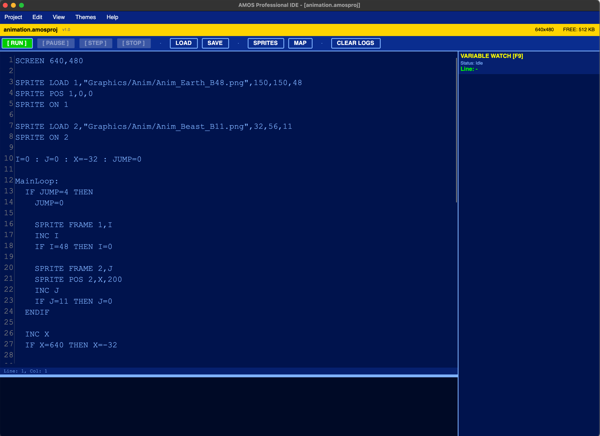
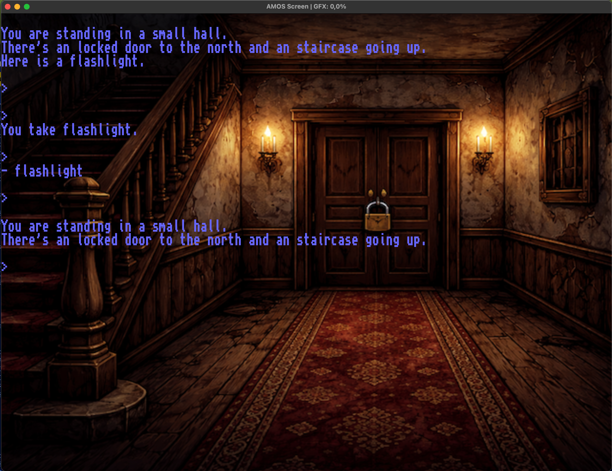
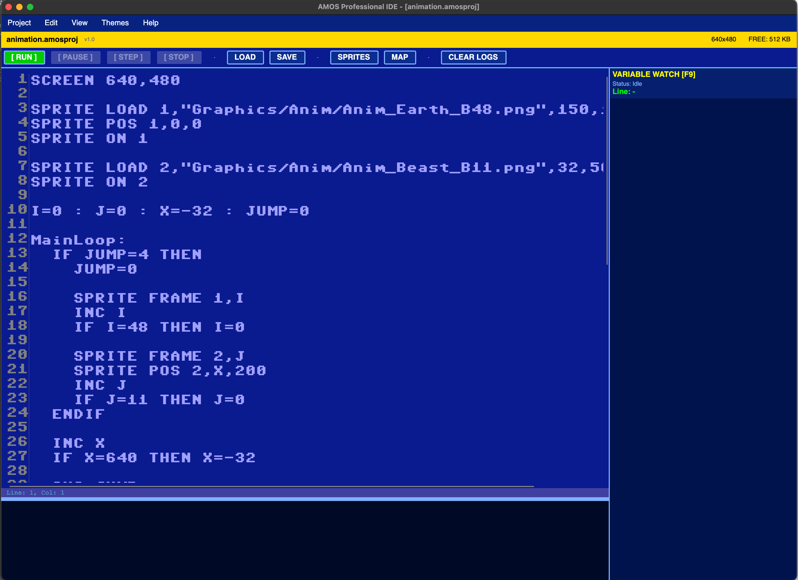
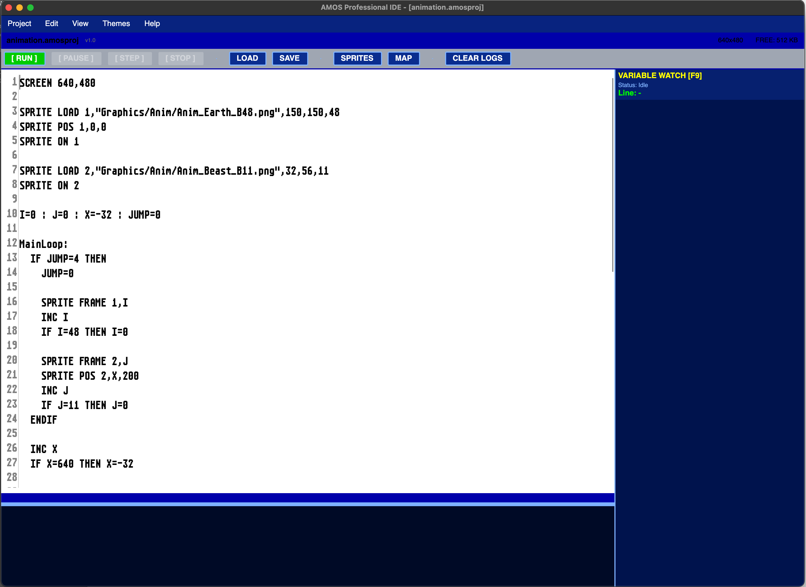
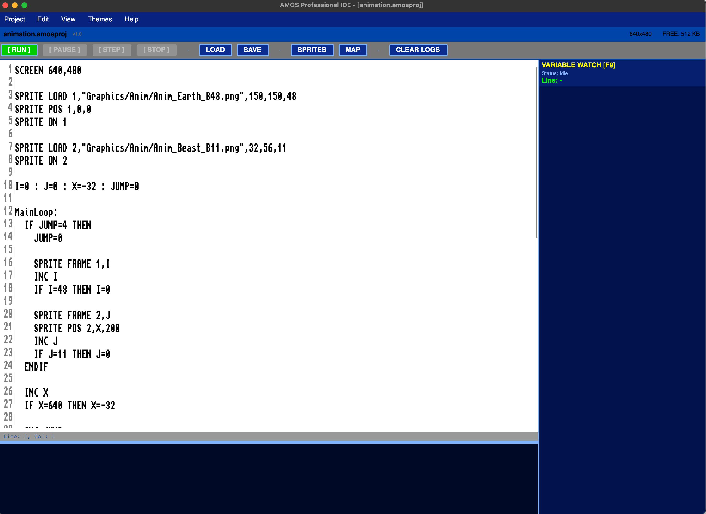

# AMOS Like Basic

**An AMOS-inspired BASIC environment for modern macOS and Windows.**

AMOS Like Basic brings back the workflow of the classic Amiga **AMOS Professional**: write a few lines of BASIC, press run, and get sprites, raster bars, scrolling tilemaps and music on screen right away. It is not an emulator. It is a new engine built on .NET, Avalonia and SkiaSharp, with modern GPU rendering and none of the old hardware limits.



---

## Features

- **AMOS-style BASIC**: `GOTO`/`GOSUB`, `PROC`, `FUNCTION`, `FOR`/`WHILE`/`REPEAT`/`DO`, `SELECT CASE`, multi-dimensional arrays, `DATA`/`READ` and `ON ERROR`.
- **Screens and layers**: multiple screens composited on the GPU, each with its own opacity, fades and SkSL shader.
- **Raster bars**: copper-style gradient bars with wrap-around, plus built-in weather (snow, rain, stars) and full-screen shaders such as Star Nest and clouds.
- **Sprites and bobs**: sprite sheets, animations, rotation, zoom, alpha fades, groups, and box, circle and pixel-perfect collision.
- **Bitmap fonts**: fonts from images, with rotation, zoom and effects.
- **Effects**: wave, blur and color grading on sprites and font texts.
- **Tilemaps**: tile sets, maps, scrolling, and a built-in map editor.
- **Sound and music**: MOD music, samples, and a chiptune synth with ready-made sound effects (`COIN`, `JUMP`, `LASER`, `EXPLOSION` and more).
- **Input**: keyboard, plus joystick and gamepad through SDL2.
- **IDE**: syntax-highlighting editor, breakpoints and single-stepping, a variable and array viewer, a sprite editor, and selectable retro themes.

---

## A taste of the language

```basic
SCREEN 640, 480
RASTER 1, 0, 0, 480, "Red, Orange, Yellow, Green, Blue, Indigo, Violet"

FONT LOAD 0, "Graphics/font.png", 32, 25
FONT MAP 0, "ABCDEFGHIJKLMNOPQRSTUVWXYZ!?:;0123456789@()£$%.’[]”,-"
FONT EFFECT ADD 0, BLUR 2.0
FONT EFFECT ADD 0, WAVE, 20, 0.05, 20, 0.02

SPRITE LOAD 1, "Graphics/hero.png"
SPRITE ON 1

Y = 0
Loop:
  FONT CLEAR
  FONT PRINT #0, 120, 200, "HELLO AMOS"
  RASTER MOVE 1, Y
  INC Y : IF Y = 480 THEN Y = 0
  WAIT VBL
GOTO Loop
```

Effects belong to the font, so they survive `FONT CLEAR`. Slow effects like blur are computed once, and wave animates by itself every `WAIT VBL`.

The `Projects/` folder contains many more examples: games (`galaga`, `phalanx`, `Jumping Jack`, `adventure`), raster and shader demos (`raster`, `raster_new`, `tunnel`, `rain`), and small focused tests. The full command reference is in [`Documentation/AMOSLikeBasic Manuall.pdf`](Documentation/AMOSLikeBasic%20Manuall.pdf).

---

## Getting started

### Prerequisites

- [.NET 9 SDK](https://dotnet.microsoft.com/download) or later
- macOS (Apple Silicon) or Windows (x64)
- Optional: JetBrains Rider, Visual Studio 2022 or VS Code

### Build and run

```bash
git clone https://github.com/MrSkutt/AmosLikeBasic
cd AmosLikeBasic
dotnet run
```

NuGet packages are restored automatically. The native audio and input libraries for your platform (`libs/mac` or `libs/windows`) are copied next to the executable at build time.

### Dependencies

| Package | Used for |
|---|---|
| Avalonia, Avalonia.Desktop, Avalonia.Themes.Fluent | UI framework and windowing |
| Avalonia.AvaloniaEdit | Code editor |
| SkiaSharp | GPU rendering and SkSL shaders |
| ManagedBass, ManagedBass.Mix, Un4seen.Bass | Audio and MOD playback |
| SDL2-CS.NetCore | Joystick and gamepad input |

---

## Project layout

| Path | Contents |
|---|---|
| `AmosRunner.cs` | The BASIC interpreter |
| `AmosGraphics.cs` | Screens, layers, sprites, fonts, raster bars, effects and GPU rendering |
| `Shaders.cs` | SkSL shaders for raster bars, weather and full-screen effects |
| `ChiptuneSynth.cs`, `AudioEngine.cs`, `LibXmp.cs` | Sound effects, synth and music |
| `MainWindow.axaml(.cs)` | The IDE |
| `SpriteEditorWindow`, `MapEditorWindow`, `TilePaletteWindow` | Built-in editors |
| `Projects/` | Example programs (`.amosproj`) |
| `Graphics/`, `Sound/`, `fonts/` | Assets used by the examples |

### Resources

Assets are located by `ResourceLoader`, which looks in the following places relative to the executable:

- the application folder
- a `Resources` folder next to the executable
- `../Resources` inside a macOS app bundle

---

## Status

Under active development. Commands, APIs and internal architecture may still change.

---

## Screenshots

| | |
|---|---|
|  |  |
|  |  |

---

## License

MIT License

Copyright (c) 2025 Mattias Schütt

Permission is hereby granted, free of charge, to any person obtaining a copy
of this software and associated documentation files (the "Software"), to deal
in the Software without restriction, including without limitation the rights
to use, copy, modify, merge, publish, distribute, sublicense, and/or sell
copies of the Software, and to permit persons to whom the Software is
furnished to do so, subject to the following conditions:

The above copyright notice and this permission notice shall be included in all
copies or substantial portions of the Software.

THE SOFTWARE IS PROVIDED "AS IS", WITHOUT WARRANTY OF ANY KIND, EXPRESS OR
IMPLIED, INCLUDING BUT NOT LIMITED TO THE WARRANTIES OF MERCHANTABILITY,
FITNESS FOR A PARTICULAR PURPOSE AND NONINFRINGEMENT. IN NO EVENT SHALL THE
AUTHORS OR COPYRIGHT HOLDERS BE LIABLE FOR ANY CLAIM, DAMAGES OR OTHER
LIABILITY, WHETHER IN AN ACTION OF CONTRACT, TORT OR OTHERWISE, ARISING FROM,
OUT OF OR IN CONNECTION WITH THE SOFTWARE OR THE USE OR OTHER DEALINGS IN THE
SOFTWARE.
