# AMOS Like Basic

[](https://github.com/MrSkutt/AmosLikeBasic/actions/workflows/tests.yml)

**An AMOS-inspired BASIC environment for modern macOS and Windows.**

AMOS Like Basic brings back the workflow of the classic Amiga **AMOS Professional**: write a few lines of BASIC, press run, and get sprites, raster bars, scrolling tilemaps and music on screen right away. It is not an emulator. It is a new engine built on .NET, Avalonia and SkiaSharp, with modern GPU rendering and none of the old hardware limits.

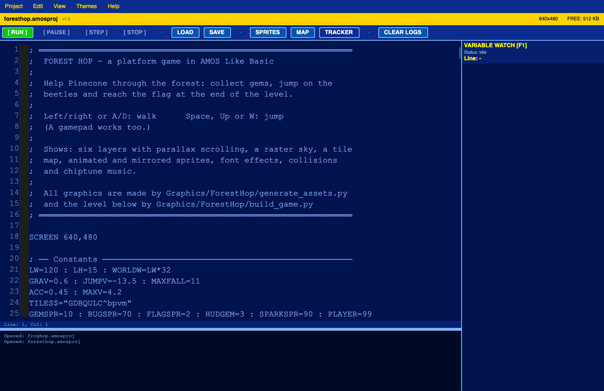

---

## Features

- **AMOS-style BASIC**: `GOTO`/`GOSUB`, `PROC` with `LOCAL`, `FUNCTION`, `FOR`/`WHILE`/`REPEAT`/`DO`, `SELECT CASE`, multi-dimensional arrays, `DATA`/`READ`, `CONST` and `ON ERROR`. Expressions are compiled to trees the first time they run, so game loops stay fast.
- **Screens and layers**: multiple screens composited on the GPU, each with its own opacity, fades and SkSL shader. `WAIT VBL` follows the screen's real refreshes for smooth scrolling.
- **CRT effect**: scanlines, a curved tube, phosphor mask, vignette and soft pixels over the whole game window, `PRINT` text included, with a settings window and ready-made looks (`SCREEN CRT`, F8).
- **Raster bars**: copper-style gradient bars with wrap-around, plus built-in weather (snow, rain, stars) and full-screen shaders such as Star Nest and clouds.
- **Sprites and bobs**: sprite sheets, animations, rotation, zoom, alpha fades, groups, and box, circle and pixel-perfect collision.
- **Bitmap fonts**: fonts from images, with rotation, zoom and effects, plus TrueType fonts in the graphics; the C64 fonts with all their PETSCII characters (`PETSCII$`) and a C64-style `PRINTG` that wraps and scrolls.
- **Effects**: wave, blur and color grading on sprites and font texts.
- **Tilemaps**: tile sets, maps, scrolling, and `MAP OBJECTS`, which turns marker tiles into the places of coins, enemies and the start.
- **Sound and music**: MOD music, samples, and a real-time stereo chiptune synth in the spirit of the C64 SID and the NES: eight channels, two oscillators per voice, two LFOs, pulse width modulation, filters with envelopes, echo, panning, arpeggio, vibrato, ring modulation and sync, plus ready-made sound effects (`COIN`, `JUMP`, `LASER`, `EXPLOSION` and more). All of it works from `PLAY` as well.
- **Tracker**: a ProTracker-style music editor in the IDE with 4 – 8 channels, an oscilloscope per channel (click to mute, right-click for solo), a volume column and ProTracker effects. The instrument page works like a software synth, with knobs, graphs and a live oscilloscope, and a held note changes as you turn a knob. Instruments can also be sampled, playing a WAV file at the note's pitch with a loop, as on the Amiga, and ProTracker MOD and FastTracker 2 XM files can be opened in the tracker and edited. A library of 70 instruments in eleven categories, from basses and leads to drums, samples and effects, and songs can be saved as WAV. Songs are played with `TRACK PLAY`, and tracker instruments double as sound effects with `TRACK SFX`.
- **Sprite and map editors**: pencil, line, rectangle, ellipse, fill and colour picker, undo, mirror drawing, the sprite's own colours and an animation preview; sprite sheets split with a frame grid you can see. Both editors open the pictures, tiles and maps the program loads, with its sizes, and the map editor shows marker tiles as the figures the game puts there.
- **Input**: keyboard, plus joystick and gamepad through SDL2.
- **IDE**: a code editor with syntax colours, completion of commands, sub-commands, functions and your own names, help when you hover a command, variable values when you hover them while the program runs, F1 for the manual's section, and runtime errors underlined on their line; breakpoints and single-stepping, a variable watch where values and array elements can be changed while paused, selectable retro themes, movable folders for projects, graphics, sound and exports, and export of a program as a standalone app.

---

## A taste of the language

```basic
SCREEN 640, 480
RASTER 1, 0, 0, 480, "Red, Orange, Yellow, Green, Blue, Indigo, Violet"

FONT LOAD 0, "Graphics/font.png", 32, 25
FONT MAP 0, "ABCDEFGHIJKLMNOPQRSTUVWXYZ!?:;0123456789@()£$%.’[]”,-"
FONT EFFECT ADD 0, BLUR 2.0
FONT EFFECT ADD 0, WAVE, 20, 0.05, 20, 0.02

SPRITE LOAD 1, "Graphics/hero.png"
SPRITE ON 1

Y = 0
Loop:
  FONT CLEAR
  FONT PRINT #0, 120, 200, "HELLO AMOS"
  RASTER MOVE 1, Y
  INC Y : IF Y = 480 THEN Y = 0
  WAIT VBL
GOTO Loop
```

Effects belong to the font, so they survive `FONT CLEAR`. Slow effects like blur are computed once, and wave animates by itself every `WAIT VBL`.

### Forest Hop

`Projects/foresthop.amosproj` is a complete platform game written in the language. It shows off what the engine can do: six parallax layers, a raster-bar sky, a tilemap level, animated and mirrored sprites, stompable enemies, fonts with wave effects, and tracker music. All of its graphics are generated by [`Graphics/ForestHop/generate_assets.py`](Graphics/ForestHop/generate_assets.py), and the level is built by [`Graphics/ForestHop/build_game.py`](Graphics/ForestHop/build_game.py).

`Projects/froghop.amosproj` is a smaller climbing game drawn entirely with code, using double buffering and sound effects made in the tracker.

The `Projects/` folder contains 28 examples, which the IDE lists under **Project → Examples**, sorted into *Games*, *Graphics and effects* and *Sound and music*. Hover over a name to see what it shows. The list is in [`Examples.cs`](Examples.cs); a test checks that it matches the files in `Projects/`, so a new example must be added there too.

Put your own experiments in a `Sandbox/` folder in the project folder. It is ignored by git, so nothing there ends up on GitHub, and file paths such as `"Graphics/hero.png"` work from there just as they do from `Projects/`. The manual, a step-by-step guide plus a full command reference, is in [`Documentation/AMOS Like Basic - Manual.pdf`](Documentation/AMOS%20Like%20Basic%20-%20Manual.pdf). It is built from the Markdown chapters in `Documentation/Manual` with `python3 Tools/build_manual.py`.

---

## Getting started

### Download

Ready-to-run versions for macOS (Apple Silicon) and Windows (x64) are on the [Releases](https://github.com/MrSkutt/AmosLikeBasic/releases) page. Unzip and start; nothing else needs installing. The manual is in the zip file too.

- **Mac:** the app is not signed by Apple, so the first time you right-click it and choose **Open**.
- **Windows:** if SmartScreen warns, click **More info** and **Run anyway**.

On the first start the example projects, graphics and sounds are copied to `Documents/AmosLikeBasic` (with an `Export` folder for exported games). That folder is where your programs count their file paths from, so put your own images and sounds there (for example `Documents/AmosLikeBasic/Graphics/hero.png`). **Project → Folders...** moves the Projects, Graphics, Sound and Export folders elsewhere.

To build and run from the source code instead:

### Prerequisites

- [.NET 9 SDK](https://dotnet.microsoft.com/download) or later
- macOS (Apple Silicon) or Windows (x64)
- Optional: JetBrains Rider, Visual Studio 2022 or VS Code

### Build and run

```bash
git clone https://github.com/MrSkutt/AmosLikeBasic
cd AmosLikeBasic
dotnet run
```

NuGet packages are restored automatically. The native audio and input libraries for your platform (`libs/mac` or `libs/windows`) are copied next to the executable at build time.

### Running the tests

```bash
dotnet test Tests/AmosLikeBasic.Tests.csproj
```

The tests run headless, without opening any windows, and take about two minutes. They check that:

- every code example in the manual and every example project runs without errors;
- the language gives the answers the manual promises (comparisons, string functions, `FOR`, `SWAP` ...);
- the synth keeps time and pitch; oscillator 2, the LFOs, echo, panning and the tracker effects do what they should, measured in the rendered sound; every song in `Sound/Tracker` loads, saves and plays, and every library instrument sounds without clipping;
- sound effects use channels 5 – 8 and give them back;
- the tracker editor responds to its keys (notes, effects, transpose, copy and paste, undo);
- the drawing tools, the sprite sheet guess, the folders and the variable watch work.

They run on GitHub for every push and pull request.

### Making a release

Push a version tag, and GitHub Actions runs the tests, builds the downloads for Mac and Windows and publishes them as a release:

```bash
git tag v0.9.0
git push origin v0.9.0
```

To build the same zip files on your own Mac, run `python3 Tools/build_release.py 0.9.0`; they end up in `Export/Release/`.

### Dependencies

| Package | Used for |
|---|---|
| Avalonia, Avalonia.Desktop, Avalonia.Themes.Fluent | UI framework and windowing |
| Avalonia.AvaloniaEdit | Code editor |
| SkiaSharp | GPU rendering and SkSL shaders |
| ManagedBass, ManagedBass.Mix, Un4seen.Bass | Audio and MOD playback |
| SDL2-CS.NetCore | Joystick and gamepad input |

---

## Project layout

| Path | Contents |
|---|---|
| `AmosRunner.cs`, `AmosRunner.Compiled.cs` | The BASIC interpreter, and its expression compiler |
| `AmosGraphics.cs` | Screens, layers, sprites, fonts, raster bars, effects and GPU rendering |
| `Shaders.cs` | SkSL shaders for raster bars, weather and full-screen effects |
| `DisplayClock.cs` | `WAIT VBL`: frames in step with the screen's refreshes |
| `ChiptuneSynth.cs`, `ChiptuneSynth.Tracker.cs`, `ChiptuneSynth.Export.cs`, `AudioEngine.cs`, `LibXmp.cs` | Sound effects, synth, tracker playback, WAV export and music |
| `Tracker.cs`, `TrackerWindow.axaml`, `PatternView.cs`, `ChannelScopes.cs`, `Knob.cs`, `InstrumentGraphs.cs`, `InstrumentLibrary.cs` | The tracker song format, editor, instrument page and library |
| `MainWindow.axaml(.cs)` | The IDE |
| `SpriteEditorWindow`, `MapEditorWindow`, `GridTools.cs`, `SheetGuess.cs`, `ProgramAssets.cs` | Built-in editors, their drawing tools, and the pictures a program loads |
| `Workspace.cs`, `ResourceLoader.cs` | The working folders and finding files |
| `Projects/` | Example programs (`.amosproj`) |
| `Tests/` | Automated tests (xUnit, Avalonia headless) |
| `Graphics/`, `Sound/`, `fonts/` | Assets used by the examples; `Sound/Instruments` is the instrument library |
| `Tools/` | Building the manual, releases, exported apps, the instrument library and songs |

How the parts fit together, in which thread, and the order things are called in, is described in [`Documentation/Architecture.md`](Documentation/Architecture.md).

### Exporting a program as an app

Any program can be turned into a standalone app for macOS and Windows. .NET is included, so players do not need to install anything:

```bash
python3 Tools/export_app.py Projects/foresthop.amosproj --name ForestHop
```

This builds `Export/ForestHop.app` and `Export/ForestHop-win/ForestHop.exe`, each with a `.zip` ready to share. Use `--platform mac` or `--platform win` to build only one of them. Only the images and sounds the program refers to are included; use `--include <file or folder>` for files whose names are built in code. `--icon picture.png` sets the Mac icon.

The app is AmosLikeBasic in player mode: when it finds a `game.amosproj` next to itself (or in `Resources` inside a Mac bundle), it opens only the game window and runs the program. F12 toggles full screen. You can try player mode without exporting:

```bash
dotnet run -- --play Projects/foresthop.amosproj
```

The Mac app must be built on a Mac and is only ad-hoc signed, so the first time players need to right-click it and choose Open. Distributing it without that warning requires an Apple Developer ID and notarization. The Windows version can be built on a Mac, and Windows may show a SmartScreen warning for unsigned apps.

### Resources

Assets are located by `ResourceLoader`, which looks in this order:

- a Graphics or Sound folder moved in **Project → Folders**
- the working folder (the repository, or `Documents/AmosLikeBasic` when installed), so your own copy of a file comes first
- the files inside the app: next to the executable, a `Resources` folder next to it, or `../Resources` inside a macOS app bundle

---

## Status

Under active development. Commands, APIs and internal architecture may still change.

---

## Screenshots

| | |
|---|---|
| 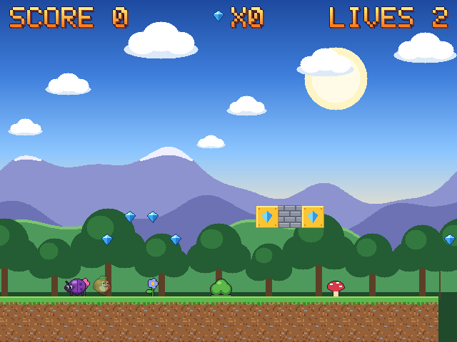 | 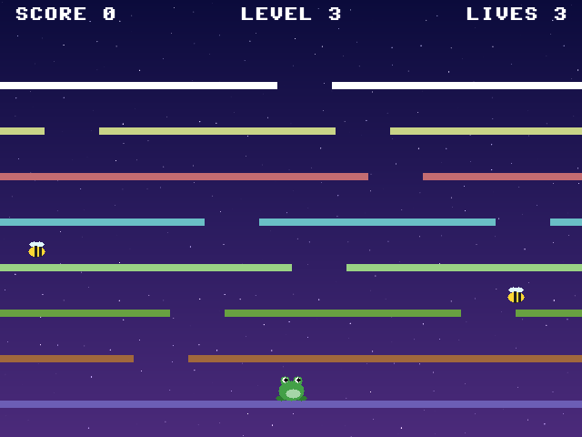 |
| *Forest Hop* | *Frog Hop* |
| 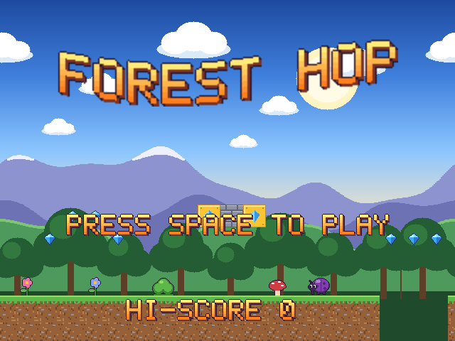 | 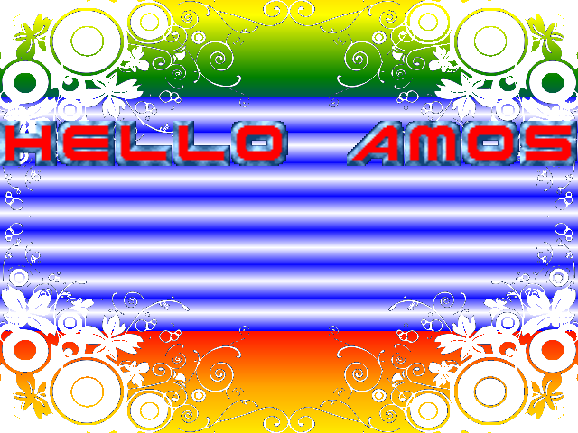 |
| *The Forest Hop title screen* | *Raster bars* |

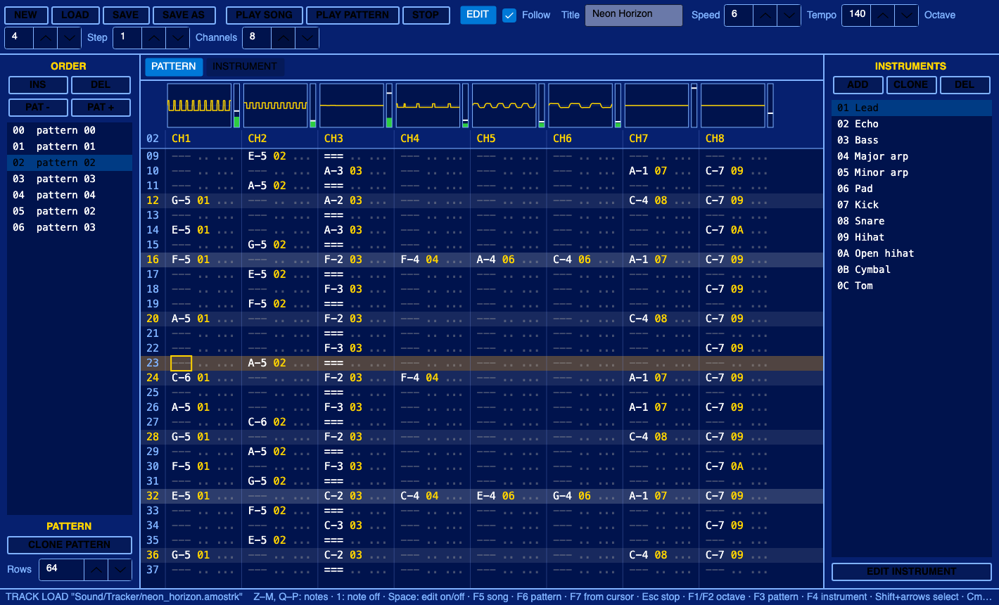
*The tracker playing Steel Sprint: an oscilloscope and level meter per channel (click to mute, right-click for solo) and ProTracker-style effects*

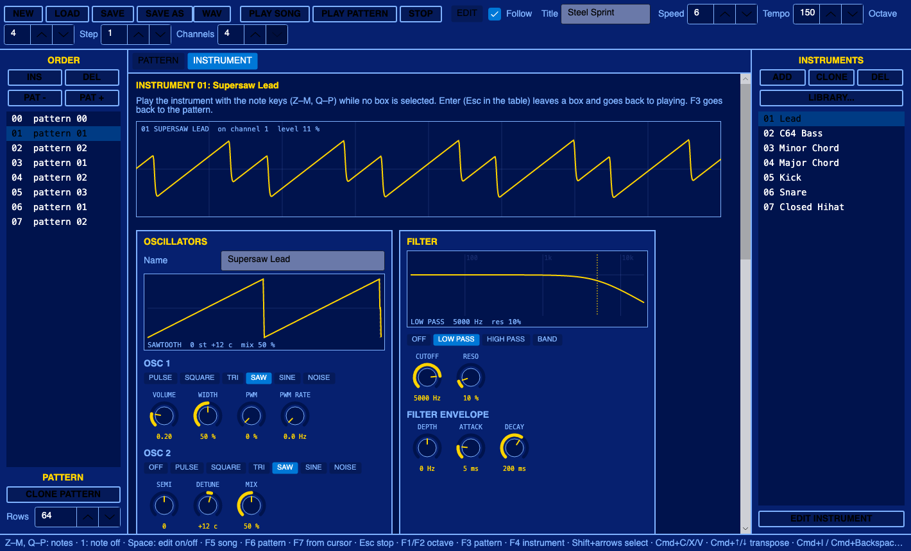
*The instrument page laid out like a software synth: a live oscilloscope, oscillators, filter, envelope, effects and LFOs, with knobs*

| | |
|---|---|
| 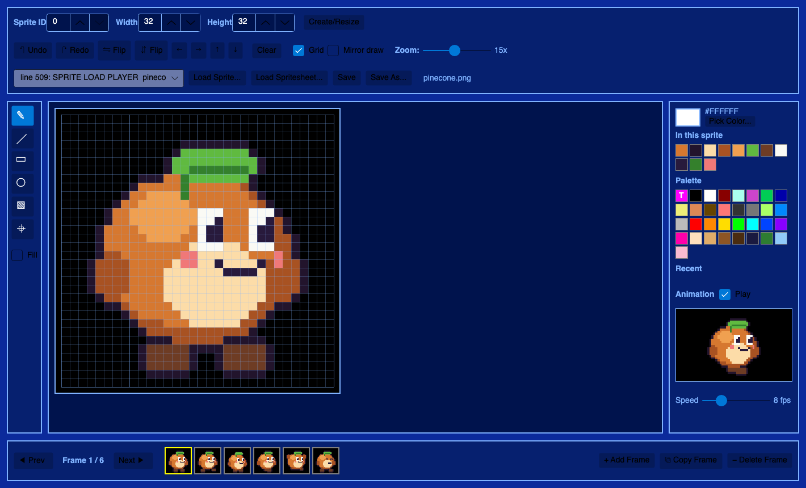 | 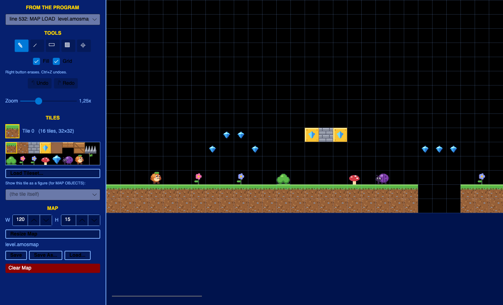 |
| *The sprite editor: Pinecone opened straight from Forest Hop's program, with drawing tools, its own colours and the animation* | *The map editor: Forest Hop's level, with gems, beetles and Pinecone shown where the game puts them* |

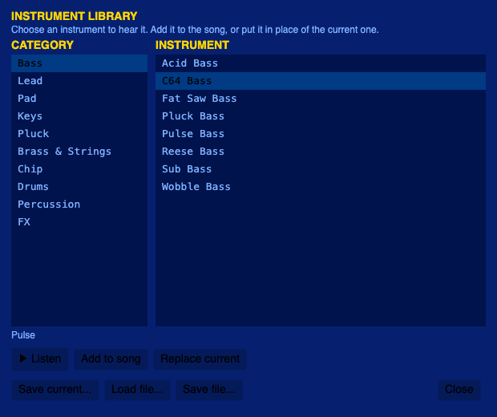
*The instrument library: ready-made instruments in categories*

| | |
|---|---|
| 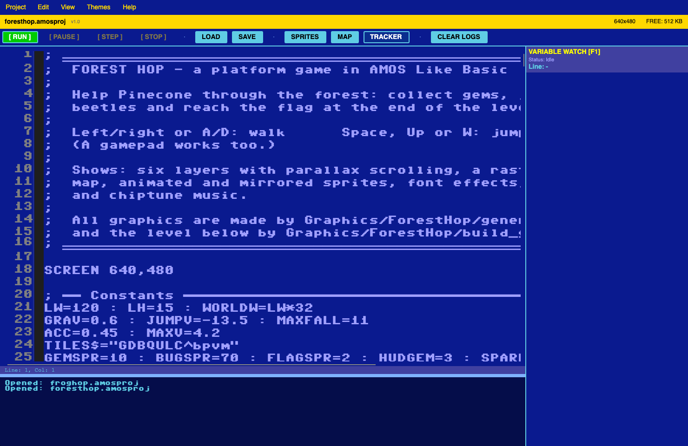 | 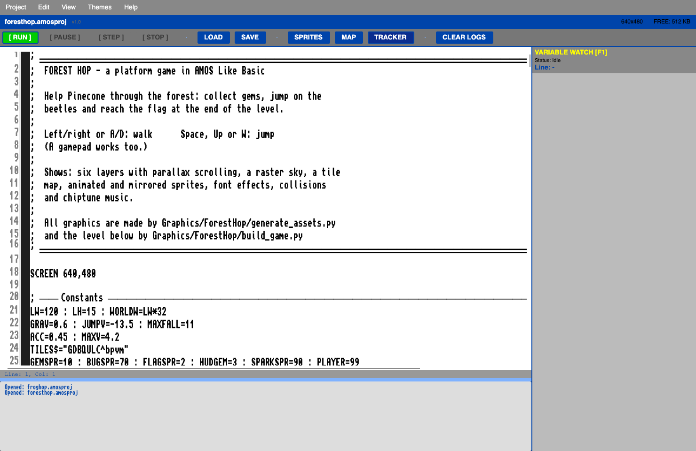 |
| *The C64 theme* | *The Workbench theme* |

---

## License

AMOS Like Basic is under the MIT licence below. The fonts in `fonts/` are not: the C64 fonts by Style may only be part of free software, and the Topaz fonts are under the GPL with the font exception. See [`fonts/LICENSES.md`](fonts/LICENSES.md). SDL2 for Windows (`libs/windows`) is under the zlib licence.

MIT License

Copyright (c) 2025 Mattias Schütt

Permission is hereby granted, free of charge, to any person obtaining a copy
of this software and associated documentation files (the "Software"), to deal
in the Software without restriction, including without limitation the rights
to use, copy, modify, merge, publish, distribute, sublicense, and/or sell
copies of the Software, and to permit persons to whom the Software is
furnished to do so, subject to the following conditions:

The above copyright notice and this permission notice shall be included in all
copies or substantial portions of the Software.

THE SOFTWARE IS PROVIDED "AS IS", WITHOUT WARRANTY OF ANY KIND, EXPRESS OR
IMPLIED, INCLUDING BUT NOT LIMITED TO THE WARRANTIES OF MERCHANTABILITY,
FITNESS FOR A PARTICULAR PURPOSE AND NONINFRINGEMENT. IN NO EVENT SHALL THE
AUTHORS OR COPYRIGHT HOLDERS BE LIABLE FOR ANY CLAIM, DAMAGES OR OTHER
LIABILITY, WHETHER IN AN ACTION OF CONTRACT, TORT OR OTHERWISE, ARISING FROM,
OUT OF OR IN CONNECTION WITH THE SOFTWARE OR THE USE OR OTHER DEALINGS IN THE
SOFTWARE.
